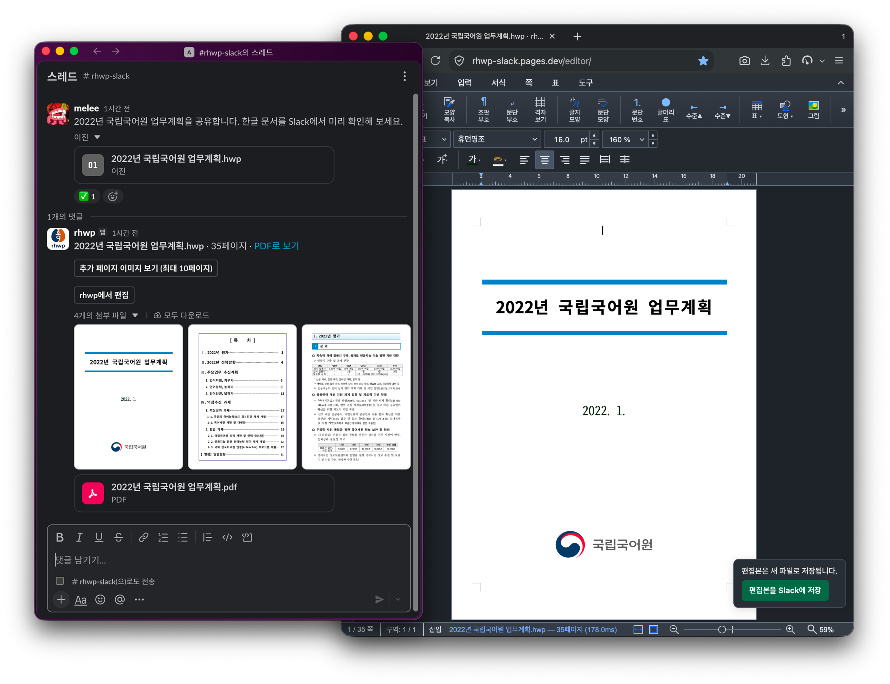

# rhwp for Slack

Slack에 올린 **HWP·HWPX 문서를 PDF와 페이지 이미지로 확인하고, 브라우저에서 무료로 편집**하세요. 편집본은 원본 메시지의 같은 스레드에 새 파일로 저장됩니다.

**[Slack에 추가하기](https://rhwp-bot.pages.dev/) · [시연 영상](https://rhwp-bot.pages.dev/#demo-video) · [사용 안내](https://rhwp-bot.pages.dev/guide/)**

> 현재 무료 베타로 제공하며 Slack Marketplace에는 아직 등재되지 않았습니다.

## 무료 베타 참여 팀 모집

Slack에서 한글 문서를 주고받는 팀이라면 설치하고 사용 경험을 알려 주세요. 실제 사용 의견을 바탕으로 서비스를 개선하고자 합니다.

[베타 참여·피드백 안내](https://github.com/postmelee/rhwp-slack/discussions/55) · [질문·답변](https://github.com/postmelee/rhwp-slack/discussions/categories/q-a) · [기능 제안](https://github.com/postmelee/rhwp-slack/discussions/categories/ideas)

> 별도 참여 신청 없이 설치할 수 있고, GitHub 계정 없이도 [이메일](mailto:meleeisdeveloping@gmail.com)로 문의할 수 있습니다.

## 시작하기

1. [홈페이지](https://rhwp-bot.pages.dev/)에서 **Slack에 추가**를 누르고 설치할 워크스페이스를 선택하세요. 조직 정책에 따라 관리자 승인이 필요할 수 있습니다.
2. 사용할 채널에 **rhwp를 초대**하세요. 처음 초대한 채널에서는 한글 문서 자동 감지가 켜집니다. 기존에 선택한 채널 설정은 유지합니다.
3. **HWP 또는 HWPX 파일을 올리세요.** 같은 스레드에 PDF와 첫 3페이지 이미지가 준비됩니다.
4. **rhwp에서 편집**을 누르고 Slack으로 로그인하세요. 브라우저에서 수정한 뒤 **편집본을 Slack에 저장**하면 같은 스레드에서 확인하고 다시 열 수 있습니다.

이미지는 **최대 10페이지까지 추가**할 수 있습니다. 나머지 페이지는 PDF로 확인하세요. 원본 파일은 덮어쓰지 않습니다.

## 채널 설정

설정 관리자는 앱 홈의 **채널 설정** 또는 **`/rhwp`** 명령어로 동작을 바꿀 수 있습니다.

- **자동 감지:** 채널에 올린 HWP·HWPX 파일을 자동으로 처리합니다.
- **멘션 요청:** 파일이 있는 메시지나 스레드에서 `@rhwp`로 요청합니다.
- **사용 안 함:** 해당 채널에서 문서를 처리하지 않습니다.

기존 파일은 원본 메시지 메뉴의 **한글 문서 열기**로 요청할 수 있습니다. 문서를 열고 편집하는 데 관리자 권한은 필요하지 않으며, 사용자와 앱 모두 해당 채널·파일에 접근할 수 있어야 합니다.

## 사용 전에 알아두세요

- 파일당 **최대 20 MiB·200페이지**를 지원합니다. HWP3와 암호화된 파일은 지원하지 않습니다.
- PDF·이미지는 Slack에서 확인하고, 편집은 외부 브라우저에서 합니다.
- **자동 저장은 제공하지 않습니다.** 창을 닫거나 새로고침하기 전에 Slack에 저장하세요.
- 한컴오피스와 모든 서식·출력이 같다고 보장하지 않습니다. 중요한 문서는 원본을 보관하고 편집 결과를 확인하세요.
- Slack Connect의 조직 간 공유와 Enterprise Grid 조직 전체 설치는 현재 지원 범위 밖입니다.

## 문서와 개인정보

원본·편집본·PDF·이미지는 Slack에 저장합니다. 변환 서버가 문서를 임시로 내려받아 처리하며, 편집은 브라우저에서 실행합니다. 서버에는 설치 정보와 암호화된 토큰, 채널 설정, 파일·스레드 연결 정보 및 임시 작업·세션 기록을 보관합니다.

자세한 보관·삭제 범위는 [**개인정보 처리 안내**](https://rhwp-bot.pages.dev/privacy/)를 확인하세요. [이용약관](https://rhwp-bot.pages.dev/terms/)도 확인할 수 있습니다.

## 지원

[설치·사용 질문](https://github.com/postmelee/rhwp-slack/discussions/categories/q-a)은 Discussions에, 재현 가능한 오류는 [GitHub Issues](https://github.com/postmelee/rhwp-slack/issues)에 알려 주세요. 오류가 난 시각, 누른 버튼, 오류 문구를 알려 주시면 도움이 됩니다.

공개하기 어려운 문의와 데이터 삭제 요청은 [지원·이용 안내](https://rhwp-bot.pages.dev/support/) 또는 [이메일](mailto:meleeisdeveloping@gmail.com)을 이용해 주세요. 비밀번호·토큰·업무 문서 원본은 보내지 않아도 됩니다.

## 후원

rhwp for Slack은 직접 호스팅하여 무료로 제공합니다. 후원은 서버 운영비를 충당하고, 서비스를 장기적으로 유지·개선하는 데 큰 힘이 됩니다. 후원 여부와 관계없이 무료로 이용하실 수 있습니다.

**[GitHub Sponsors로 후원하기](https://github.com/sponsors/postmelee)**

## 프로젝트 정보

[관리자·개발자 문서](docs/README.md) · [기여 안내](CONTRIBUTING.md) · [보안 정책](SECURITY.md) · [라이선스와 제3자 고지](https://rhwp-bot.pages.dev/licenses/)

rhwp는 독립적으로 운영되는 서비스이며 Slack 또는 한글과컴퓨터의 공식 제품이 아닙니다.
